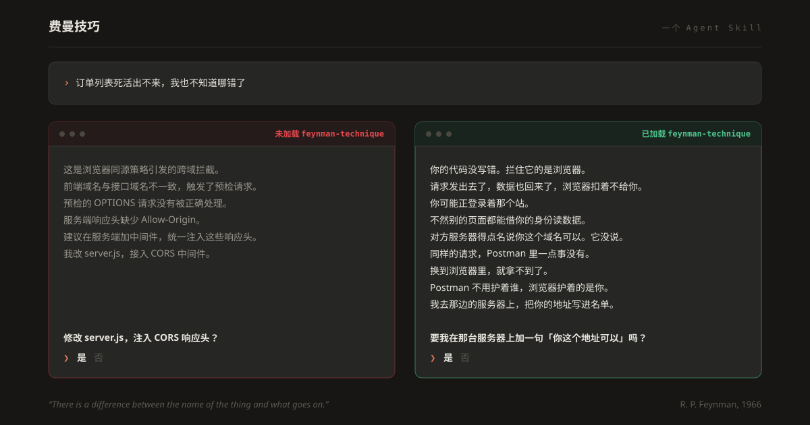

<div align="center">



# 费曼技巧

### AI 甩给你一段代码。粘上去，跑通了。为什么能跑，你还是不知道。

**这个 skill 补的就是后半句。**

[](https://agentskills.io)
[](../../LICENSE)
[](#安装)
[](#这套方法从哪儿来)

[English](../../README.md) ·
**中文** ·
[हिन्दी](README.hi.md) ·
[Español](README.es.md) ·
[Français](README.fr.md) ·
[العربية](README.ar.md) ·
[বাংলা](README.bn.md) ·
[Português](README.pt-BR.md) ·
[Русский](README.ru.md) ·
[اردو](README.ur.md)

</div>

---

## 同一个模型，同一个问题，中间只隔着一次安装

> **“为什么会报 `Cannot read properties of undefined (reading 'map')`？”**

<table>
<tr>
<th width="50%">没装这个 skill</th>
<th width="50%">装了这个 skill</th>
</tr>
<tr valign="top">
<td>

你在一个值为 undefined 的引用上调用了 `.map()`。组件的首次渲染发生在异步请求 resolve 之前，那一刻 state 变量还没初始化。把它的初始值设成空数组，或者在渲染路径上加个条件判断挡一下。

</td>
<td>

你给页面下了一道指令：把我这份清单拿去，一行一行画出来。

可清单还没到——它还在从服务器往回送的路上。那一刻页面手里根本没有清单，它伸手去拿本该在那儿的东西，扑了个空，就摔在这儿了。

先塞一份空清单给它拿着，等真的那份到了再换上。这样它先什么都不画，等着，然后一次全画出来。

</td>
</tr>
<tr valign="top">
<td>

六个你本来就得懂的词。说得没错，可你脑子里还是没有画面。

</td>
<td>

一个都不用。而且你知道该改哪一行，也知道改完会看到什么。

</td>
</tr>
</table>

两段话都没说错。但只有一段是解释。

---

## 这套方法从哪儿来

费曼小时候，父亲指着一只鸟告诉他：这只鸟的名字，你可以用地球上每一种语言叫一遍，对这只鸟却依然一无所知——你知道的只是人们管它叫什么。想认识这只鸟，得看它在干什么。

> "There is a difference between the name of the thing and what goes on."
> — Richard Feynman, *What Is Science?*, 1966
>
> *“事物的名字，和这个事物身上正在发生的事，是两码事。”*

整件事就这么简单，而绝大多数 AI 默认就栽在这儿。你问一样东西是什么，它把这东西的名字换个体面点的说法还给你。这个 skill 让模型**先讲机制，最后才给名字**——费曼当年就是这么讲的。

它取材于一手文献，不是网上谈费曼的博客。为了同时提炼出方法和文风，我们分析了他本人约 **88,000 词**的文字：《Six Easy Pieces》、1965 年诺贝尔演讲、《Cargo Cult Science》、《What Is Science?》、《There's Plenty of Room at the Bottom》，以及《Surely You're Joking, Mr. Feynman!》里写巴西的那一章。

**仓库是英文的，回答不是**——你用哪种语言写，skill 就用哪种语言答。

---

## 它使用的四项检验

不是网上流传的那个版本。下面四项是费曼自己的检验，每一项都追得到一手出处。

<table>
<tr valign="top"><td width="30%">

**复述检验**

</td><td>

*"Without using the new word which you have just learned, try to rephrase what you have just learned in your own language."*（1966）

*“不许用你刚学会的那个新词，试着用自己的话把刚学到的东西重讲一遍。”*

把那个词盖住。句子要是离了它就塌了，你写下的是定义，不是解释。

</td></tr>
<tr valign="top"><td>

**摩擦发光检验**

</td><td>

费曼随手翻开一本教科书，读到这么一句：*"Triboluminescence is the light emitted when crystals are crushed."*（“摩擦发光，是晶体被压碎时发出的光。”）他的评语是：你不过是拿另一堆词，把一个词的意思绕着说了一遍。

他自己改写成这样：*"When you take a lump of sugar and crush it with a pair of pliers in the dark, you can see a bluish flash. Some other crystals do that too. Nobody knows why. The phenomenon is called 'triboluminescence.'"*

*“在黑屋子里拿钳子夹碎一块方糖，你能看见一道淡蓝色的闪光。别的晶体也有这本事。没人知道为什么。这个现象叫‘摩擦发光’。”*

一件你动手就能做的事 → 你会看见什么 → 老实承认哪里不知道 → **到这一步才**给名字。

</td></tr>
<tr valign="top"><td>

**“看那水面”检验**

</td><td>

他在巴西的学生能把布儒斯特角一字不差地背出来。让他们拿一片偏振片对着窗外的海湾看一看，人就僵住了。

一条非得先想起关键词才够得着的解释，到了真实场景里你永远够不着。

</td></tr>
<tr valign="top"><td>

**草包族科学检验**

</td><td>

读完之后，你能做成什么以前做不成的事？形式做得再对，背后空无一物，飞机照样不会降落。

</td></tr>
</table>

---

## 安装

一个文件夹，就这么多。凡是支持 [Agent Skills 开放标准](https://agentskills.io) 的工具都能用。

```bash
git clone https://github.com/guicortei/feynman-technique.git /tmp/feynman-technique
mkdir -p ~/.claude/skills
cp -r /tmp/feynman-technique/skills/feynman-technique ~/.claude/skills/
```

这是 Claude Code 的装法。装完直接开口问：

```
/feynman-technique 讲讲数据库索引是怎么工作的
```

<details>
<summary><b>Claude Code</b>——项目级，和团队共用</summary>

```bash
mkdir -p .claude/skills
cp -r /tmp/feynman-technique/skills/feynman-technique .claude/skills/
```

提交上去，仓库里的每个人就都有了。运行 `/doctor` 确认它已加载。

</details>

<details>
<summary><b>或者用脚本</b>——顺便别让你手里那份副本过期</summary>

```bash
./install.sh              # 个人级，Claude Code
./install.sh --project    # 装进本仓库，给团队用
./install.sh --all        # 本机上有的每个工具目录
./install.sh --check      # 只报告哪几份落后了，什么都不改
```

值得记住的是 `--check`。装好的 skill 是一份**副本**，它不跟着仓库走。拉完代码跑一次 `--check`，哪一份跟仓库对不上，它会点名——不然你得等上好几周，才从一个本该早就修好的答案里发现这件事。

</details>

<details>
<summary><b>Claude.ai</b>（网页版与桌面应用）</summary>

需要 **Pro、Max、Team 或 Enterprise** 套餐，并开启代码执行。

1. 下载本仓库（[**ZIP**](https://github.com/guicortei/feynman-technique/archive/refs/heads/main.zip)）。
2. 压缩 `skills/feynman-technique` **这个文件夹本身**，让 `SKILL.md` 正好落在压缩包根目录：
   ```bash
   cd skills && zip -r feynman-technique.zip feynman-technique
   ```
3. 在 Claude 里进入 **设置 → 功能 → Skills**（部分套餐显示为 *Features*），选 **Upload skill**。
4. 选择 `feynman-technique.zip`。

你开口要讲解时 Claude 会自动用它，你也可以直接点名叫它。

> claude.ai 上的自定义 skill 按用户隔离——每位同事得自己传一份。

</details>

<details>
<summary><b>ChatGPT</b>（桌面应用）</summary>

1. 下载并解压本仓库。
2. 打开 ChatGPT 桌面应用，在侧边栏选 **Skills**。
3. 添加 `feynman-technique` 文件夹。
4. 在对话里输入 `@`，从列表中选它。

**套餐不支持 skills？** 看下面的[任何其他 AI](#任何其他-ai不支持-skills)。

</details>

<details>
<summary><b>OpenAI Codex CLI</b></summary>

```bash
git clone https://github.com/guicortei/feynman-technique.git /tmp/feynman-technique
mkdir -p ~/.agents/skills
cp -r /tmp/feynman-technique/skills/feynman-technique ~/.agents/skills/
```

改成项目级：复制到仓库根目录的 `.agents/skills/`。用 `$feynman-technique` 调用，或者运行 `/skills` 看看有哪些可用。

</details>

<details>
<summary><b>Cursor</b></summary>

```bash
git clone https://github.com/guicortei/feynman-technique.git /tmp/feynman-technique
mkdir -p ~/.cursor/skills
cp -r /tmp/feynman-technique/skills/feynman-technique ~/.cursor/skills/
```

项目级：仓库里的 `.cursor/skills/` 或 `.agents/skills/`。Cursor 也会读 `~/.claude/skills/`，所以按 Claude Code 那样装过一次就够了。在 Agent 聊天框里输入 `/`，选 **feynman-technique**。

</details>

<details>
<summary><b>VS Code / GitHub Copilot</b></summary>

```bash
git clone https://github.com/guicortei/feynman-technique.git /tmp/feynman-technique
mkdir -p ~/.copilot/skills
cp -r /tmp/feynman-technique/skills/feynman-technique ~/.copilot/skills/
```

工作区级：`.github/skills/` 或 `.agents/skills/`。在 Copilot Chat 里输入 `/`，选中这个 skill。后面可以直接接上下文：`/feynman-technique 这个仓库里的认证中间件`。

</details>

<details>
<summary><b>Gemini CLI</b></summary>

```bash
git clone https://github.com/guicortei/feynman-technique.git /tmp/feynman-technique
mkdir -p ~/.gemini/skills
cp -r /tmp/feynman-technique/skills/feynman-technique ~/.gemini/skills/
```

项目级：`.gemini/skills/` 或 `.agents/skills/`。Gemini CLI 激活 skill 前会先问你一句。

</details>

<details>
<summary><b>其他所有工具</b>——Amp、Goose、Kiro、Junie、Roo、Factory、Tabnine……</summary>

多数工具认下面几个路径之一，按普及程度大致排序：

```
~/.agents/skills/        # 正在成为跨工具通用约定
~/.claude/skills/        # 作为备选被广泛支持
<工具专属>/skills/        # 例如 ~/.gemini/skills/、~/.cursor/skills/
```

你的工具文档写的是哪个，就把 `feynman-technique` 文件夹放进哪个。完整客户端名单见 [agentskills.io/clients](https://agentskills.io/clients)。

</details>

<details>
<summary id="任何其他-ai不支持-skills"><b>任何其他 AI</b>——不需要 skills 支持</summary>

本 skill 就是一份普通 Markdown，哪里能塞系统提示词，它就能在哪里用。

- **自定义 GPT / Gem / Assistant：** 把 [`skills/feynman-technique/SKILL.md`](../../skills/feynman-technique/SKILL.md)（去掉顶部的 YAML 块）粘进指令栏，再把 `references/` 里的文件当知识文件传上去。
- **项目 / 自定义指令：** 一样的做法，粘到项目的自定义指令框里。
- **临时用一次：** 把文件粘进对话，再加一句*“接下来的对话都照这个来。”*

</details>

### 验证是否生效

拿一个你本来就很懂的问题去问：

```
/feynman-technique 什么是哈希函数？
```

答对了的样子是：开头一句话论点，接着一个**一个技术词都没有**的第 0 级，末尾收在“图像在哪里失效”一节。要是它张口就来“哈希函数是一种将任意大小的数据映射为……”，那 skill 没加载上。

---

## 你会得到什么

```
**一句话总结：** ...        ← 让专家读到这里就能停下

**要记住的图像：** ...      ← 主类比

0 · 过年饭桌   完全没有该领域背景。零技术词汇。
1 · 新人       真实的名称，挂靠在第 0 级的图像上
2 · 从业者     各部分如何咬合，以及第一个真正的取舍
3 · 维护者     失效模式、什么会坏、放弃了哪些方案及原因
4 · 专家       边界情况、规模效应，以及模型本身的极限

图像在哪里失效     ← 每个类比的边界，明确写出
本文引入的新词     ← 每个新术语一行
我略去了什么       ← 点名说明，而非悄悄省略
```

层级可以压缩，但绝不消失。问题问得窄，就给**紧凑形式**：论点、图像、真正相关的那一级。押着一位专家把五级全走一遍不叫严谨，实测下来，那是在**削弱**他的理解（[专业知识逆转效应](../../skills/feynman-technique/references/evidence.md)）。

📄 **[看一份完整答案，再看它的逐处批注](../../skills/feynman-technique/assets/worked-example.md)**——把“什么是数据库索引？”完整答一遍，每一步都标出它在干什么。

---

## 教练模式——真正让你学会的那个

```
/feynman-technique 考考我 TCP 是怎么处理拥塞的
/feynman-technique 我想检验一下自己是不是真懂事件溯源
```

这个模式下它不讲解，改由**你**讲。它只管听，专挑三样东西：含糊的地方、被你当成终点用的术语、只有断言没有机制的步骤——然后每次只点破一个洞，答案不给你。

这是研究支撑最硬的一个模式。准备去教别人的学习者，成绩好过准备去考试的学习者，**哪怕那堂课根本没发生**（Nestojko 等，2014）。自己生成一遍解释，效果胜过读别人写好的（Chi 等，1989）。

---

## 它遵守的规矩

| | 常见的“讲简单点”提示词 | 本 skill |
|---|---|---|
| **行话** | 句子变简单，术语照旧 | 每个新术语首次出现就解释，否则干脆不出现 |
| **类比** | 每段换一个比喻 | 一个主类比，靠不断加情节把它撑开——**并说明它在哪里失效** |
| **准确性** | 简化到出错 | 近似都标出来，*连同它的适用范围* |
| **深度** | 只有一层，还是平的 | 一道阶梯，你想在哪一级下来都行 |
| **专家** | 被居高临下地哄 | 第一行就给论点，然后转紧凑形式 |
| **名字** | 名字**就是**答案 | 机制在前，名字在后 |
| **无知** | 一笔带过 | 该说“没人知道”的地方就明说 |
| **学习** | 冲着你讲 | 教练模式让**你**讲，然后揪出你的漏洞 |

第零条规矩：**讲得清楚，永远不能拿来当讲错的借口。** 一旦简化会失真，它就直说，给出适用范围，再把上一级的准确版本端出来。

---

## 里面都有什么

skill 文件本身保持英文，以保证 frontmatter 写法统一。

| 文件 | 内容 |
|---|---|
| [**SKILL.md**](../../skills/feynman-technique/SKILL.md) | skill 本体。从这里看起。 |
| [references/voice.md](../../skills/feynman-technique/references/voice.md) | 费曼文风的取证式分析，附语料统计 |
| [references/ladder.md](../../skills/feynman-technique/references/ladder.md) | 层级校准，以及怎么调整整体形状 |
| [references/analogies.md](../../skills/feynman-technique/references/analogies.md) | 构建、延展与压力测试类比 |
| [references/failure-modes.md](../../skills/feynman-technique/references/failure-modes.md) | 讲解失败的 14 种方式，每种附改写 |
| [references/evidence.md](../../skills/feynman-technique/references/evidence.md) | 学习科学依据——以及本方法真正失效之处 |
| [references/sources.md](../../skills/feynman-technique/references/sources.md) | 已核实的引语，以及被硬安在他名下的那些 |
| [assets/checklist.md](../../skills/feynman-technique/assets/checklist.md) | 发出去之前的自查清单 |

### 文风取证分析一瞥

全部按那 88,000 词的语料实测：

- **句子忽长忽短，这是他的招牌。** 句长中位数约 20 词——但大约每 8 句有 1 句不到八个词，每 6 句有 1 句超过三十五词。他把句子铺得很长，然后用一记短句落地。*"Shake this one, that one shakes later."*
- **代词跟着功能换。** 讲课时用“we”（《Six Easy Pieces》里每千词 19.95 次，是他用“I”的十倍）；承认自己糊涂时用“I”（诺贝尔演讲每千词 26.7 次）；教你动手时用“you”（《Cargo Cult Science》每千词 20.6 次）。
- **身上能感觉到的动词。** *jiggle* 27 次、*pull* 37 次、*push* 28 次、*shake* 20 次。分子在**抖**，不是在“表现出热运动”。
- **“Basically”在 88,000 词里出现零次。** *Trivial* 出现一次。skill 禁用这些词就是这么来的——靠测量，不是靠口味。

---

## 诚实的局限

第零条规矩也管着这个页面自己。

- **费曼没有发明“费曼技巧”。** 他从未发表过一套叫这个名字的四步法。那四步是后来的普及者拼出来的，主要出自 Scott H. Young 在 2011 年前后的整理。本 skill 改用他**有据可查**的那些检验，并把这件事说明白。
- **“如果你不能简单地解释它，你就没有真正理解它”**——这句话安在费曼头上还是爱因斯坦头上，都找不到一手出处。[sources.md](../../skills/feynman-technique/references/sources.md) 列出了他确实说过的，以及他没说过的。
- **有些东西简化不了。** 费曼自己就撞过这堵墙：他父亲问他，光子本来不在原子里，怎么会从原子里跑出来，他的回答是 *"I'm sorry; I don't know. I can't explain it to you."* 本 skill 就是照着“该说这句话就说”来设计的，而不是编一幅假图像出来。
- **它要花 token，也要花时间。** 只是快速查一下的话，用紧凑形式、或者干脆不用这个 skill，才是对的选择。
- **对死记硬背和动作技能帮助不大。** 它冲着因果和机制层面的理解去。背单词、记快捷键靠的是间隔提取练习，不是讲解。
- **好的讲解会让人“觉得”自己懂了。** 那种感觉不是证据。真要紧的时候，用教练模式。

---

## 致谢与版权

理查德·P·费曼（1918–1988）写下了这里所有值得读的东西。本仓库放的是**推导出的规则和标明出处的简短引语**，供分析和教学之用，并不转载他的作品。

他的文字仍在版权保护期内：《The Feynman Lectures on Physics》可以在 [feynmanlectures.caltech.edu](https://www.feynmanlectures.caltech.edu/) 免费**阅读**，但版权归 Caltech，**不属于公有领域**。你要 fork，就照这个规矩来：引用要短、出处必注、整章绝不粘贴。完整出处见 [sources.md](../../skills/feynman-technique/references/sources.md)。

本 skill 起初叫 `feynman-reply`，是 [@guicortei](https://github.com/guicortei) 写的一个葡萄牙语 skill。后来按一手材料重建，从软件领域推广到通用领域，又补上文风分析、证据基础和教练模式，然后改名 `feynman-technique`。

与费曼遗产管理机构、Caltech、Anthropic 都没有隶属关系，也未获它们背书。

## 参与贡献

欢迎改进，尤其欢迎这几样：其他领域的示范答案、实际用起来撞见的失败模式，以及对任何一处引语的更正。详见 [CONTRIBUTING.md](../../CONTRIBUTING.md)。

只有一个要求：你要是新增关于费曼的论断，请给出一手来源。打着他的名号谈智识诚实，出处上却马虎——这是本仓库唯一不可原谅的 bug。

## 许可证

[MIT](../../LICENSE)。随便用、随便 fork、随便发。

---

<div align="center">

> *"The first principle is that you must not fool yourself — and you are the easiest person
> to fool."*
> — Richard Feynman, *Cargo Cult Science*, 1974
>
> *“第一条原则是：绝不能欺骗自己——而你恰恰是最好骗的那个人。”*

它要是让你今天拿到的某个答案变得不一样，**[给这个仓库点个 ⭐](https://github.com/guicortei/feynman-technique)**。

</div>
